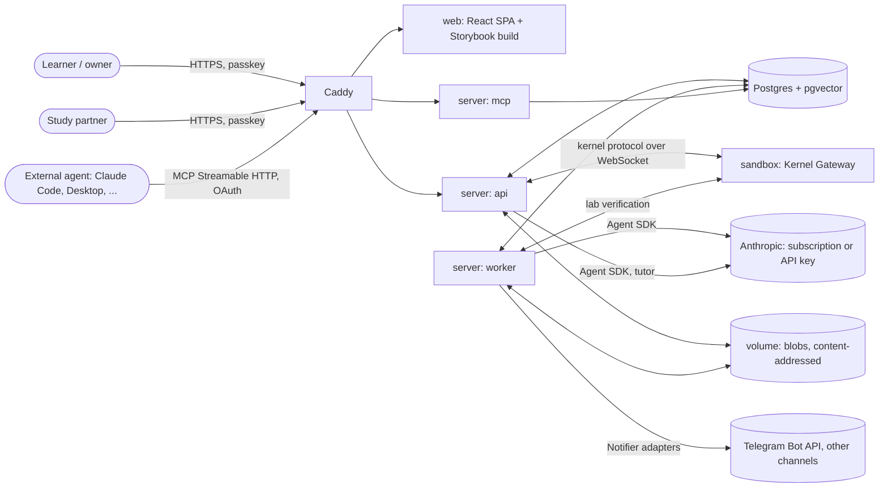

# Architecture

reader-ai is a self-hosted web application; v1 runs on the owner's Mac, a VPS follows after load is measured. It turns uploaded material (books, papers, docs, repositories) into an interactive notebook course, verifies every lesson before publishing, and runs study sessions with Claude as a tutor. Practice happens in the same notebook, against a sandboxed Jupyter kernel. A separate MCP connector exposes the knowledge built while reading to other agents.

All decisions below are recorded as ADRs in [docs/adr](adr/). Every one is `proposed` until the owner accepts it.

## Context

## Containers (ADR-0012)

| Service | Image | Role | Volumes |
| --- | --- | --- | --- |
| `caddy` | caddy:2 | TLS, routing, static SPA, security headers | `caddy_data`, `caddy_config` |
| `api` | `server` | HTTP API, SSE event streams, WebSocket kernel relay, tutor chat | `blobs` |
| `worker` | `server` | Jobs: ingestion, compile pipeline stages, embeddings, scheduled reviews | `blobs` |
| `mcp` | `server` | MCP server for the sectorized knowledge base (ADR-0015) | — |
| `kernel` | `sandbox` | Jupyter Kernel Gateway; executes lab code; no secrets, egress denied by default | `scratch` (tmpfs) |
| `postgres` | postgres + pgvector | State, event log, job queue, vectors | `pgdata` |

One Python codebase (`server/`) runs as three processes; the entrypoint selects the role. This keeps one dependency graph and one test suite.

## Core flows

### 1. Material → course (ADR-0008, ADR-0009)

```mermaid
flowchart LR
  up[Upload] --> ing[Ingest: parse, outline, chunk, embed]
  ing --> plan[Course plan: lessons, order, sessions]
  plan --> G1{{Gate G1: owner approves plan}}
  G1 --> draft[Draft lesson notebook]
  draft --> fact[Fact-check: every claim cites a span or URL]
  fact --> lab[Lab verification in sandbox]
  lab --> review[Adversarial review, fresh context]
  review -->|blocking findings| draft
  review --> G2{{Gate G2: owner publishes}}
  G2 --> pub[Published lesson revision]
```

ADR-0039 (proposed) reorders the checks after drafting: schema and citation presence by rule, lab verification, claim support by a model, adversarial review last; the first failure loops back to the draft, at most 3 times.

Each stage is an idempotent job keyed by `(lesson, stage, input_sha256)`. Outputs are immutable, content-addressed artifacts. A stage that fails or exceeds its budget stops the lesson and emits an event; it never silently degrades.

### 2. Study session (ADR-0010)

Open app → one-click resume to the exact cell → two-minute entry action (one recall card or re-running the last lab) → reading route and labs → tutor questions in the side panel → session close: recall cards scheduled by FSRS, habit tracker updated, findings filed into knowledge sectors.

### 3. Knowledge → other agents (ADR-0015)

Findings created during study (conclusions, trade-offs, decisions, open questions, errata) are stored with their source spans and tagged with sectors. The MCP server exposes them read-only by default; writes require an explicit scope. ADR-0039 (proposed) organises the knowledge base as base packs and overlays behind an append-only manifest and exposes it through the `brain/v1` contract.

### 4. Sharing and paired study (ADR-0016)

Courses are shared by role (viewer, learner, editor). A paired program is a cohort of learners on one course with shared progress, pair sessions on one notebook, and mutual check-ins. Every learner's tutor runs on that learner's own provider credentials.

## Event model (ADR-0006)

State changes are appended to an `events` table in the same transaction as the change (transactional outbox). Consumers:

- SSE streams to the browser (`/api/events?topic=...`), resumable by event id;
- the job queue (`jobs` table, `FOR UPDATE SKIP LOCKED`, woken by `LISTEN/NOTIFY`);
- the audit log and OpenTelemetry spans.

Event types are declared in one registry (`server/src/reader/events.py`) as typed Pydantic models; the registry is the contract between producers, consumers and the web client (generated TypeScript types).

## Lesson notebook format (ADR-0004)

Plain nbformat v4 `.ipynb`. reader-ai semantics live in cell metadata under the `reader` key and are validated by a JSON Schema. A lesson stays a valid notebook: it opens in JupyterLab or VS Code without reader-ai.

## Configuration and secrets (ADR-0011)

One declarative file, `reader.yaml`, validated by a JSON Schema generated from Pydantic models. Secrets are references, never values: `secret://env/NAME`, `secret://file/run/secrets/NAME`, `secret://keychain/reader-ai/NAME`, `secret://op/vault/item/field`. Keychain references are resolved on the host by the `reader` CLI (macOS Keychain, Windows Credential Locker, Linux Secret Service through `keyring`) and delivered by OPS-CLI over `docker exec` stdin into each consumer's tmpfs at `/run/secrets` (ADR-0026), never as files in the repository or on disk.

## Quality attributes

| Attribute | Target | Where verified |
| --- | --- | --- |
| Time from opening the app to the first study interaction | ≤ 2 interactions, ≤ 10 s | NFR in `WEB-SESSION`, Playwright |
| Tutor first streamed token, p95 | ≤ 3 s | NFR in `SRV-TUTOR`, bench |
| Published lesson with an unsupported factual claim | 0 | Gate G2 blocks on fact-check findings |
| Lab cell that fails in the sandbox at publish time | 0 | Lab verification stage |
| Compile cost of the whole Bashir pilot | ≤ 50% of one month of Agent SDK credit | Cost ledger (ADR-0005) |
| Secret value in logs, traces, events, notebooks | 0 | Redaction tests, CI secret scan |

Numbers without a measurement yet are hypotheses; each has a spike in [docs/adr](adr/) that measures it before the owning spec is approved.
