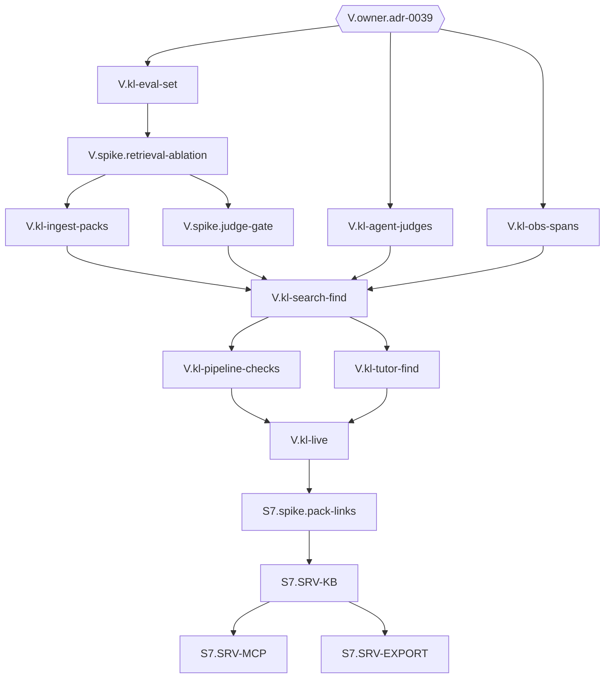

# ADR-0039 execution plan

Reference for every task that ADR-0039 adds. The agent still picks tasks from `docs/progress.yaml` (AGENTS.md "The loop"); this file says, per task, what goes in, the steps, what comes out and how it is checked.

ADR-0039 started as PR #42 (ADR-0020 on branch `s0/adr-0020-knowledge-layers`), written at stage 0 when `server/` had no code. It was renumbered and rebased onto the vertical slice on 2026-11-26. The slice already has approved, built specs for SRV-INGEST, SRV-SEARCH, SRV-AGENT, SRV-OBS, SRV-PIPELINE and SRV-TUTOR, so every module task below **revises an approved spec**: its tests change together with it (H2), and its `deep-reviewer` approval is required before the revised spec is set back to `approved`.

Nothing here starts until the owner has accepted ADR-0039 and merged its PR (`V.owner.adr-0039`, rule A9).

## Owner decisions behind this plan

ADR-0039 Context, decisions 1–19, and the owner's answers of 2026-11-26 on the rebase:

| Question | Answer | Consequence |
| --- | --- | --- |
| Span ids | Migrate to locators | Span identity becomes the ADR-0008 locator (page, character offsets) plus a quote hash; FR-INGEST-17's `<material_sha256>:<seq>` and every stored citation migrate |
| Online judge | Full ADR: online judge in `find` | One `judge.find` call per `find`, last; ADR-0025 is amended so this call reaches agent-proxy outside the worker's single job slot |
| Pipeline order | Apply decision 18 fully | Rules → lab → claim support → adversarial review, at most 3 loops, every return counted; fact-check through the search route. This replaces the measured one-loop deviation in SRV-PIPELINE |
| Timing | Build it all now | Packs, overlays, manifest with CAS, GC, facets and the full `find` cascade on the current single source, not at stage 7 |

## Order of the tasks

The hexagon is the owner's step. `V.kl-agent-judges` and `V.kl-obs-spans` run in parallel with the evaluation set and the ablation. The `Provider` port already exists (SRV-AGENT, FR-AGENT-5), so the first draft's "SRV-AGENT before SRV-SEARCH" ordering is gone.

## Already done under another name

| Plan item of the first draft | Where it is now |
| --- | --- |
| `S0.spike.trace-backend`, MLflow chosen | Done; ADR-0032 (accepted) deploys MLflow on SQLite behind the owner gate |
| Prompt files registered in MLflow | FR-OBS-15 (`obs.prompts` job), ADR-0035 |
| Evaluation datasets in MLflow | `search-bench-v1`, `tutor-bench-v2` (FR-OBS-22, ADR-0038) |
| `observability` profile; search works with MLflow stopped | FR-OBS-8, INV-OBS-3 |
| Exact distance scan | FR-SEARCH-7: 6.6 ms at 2,285 chunks; live search p95 173 ms (V.SRV-SEARCH-min) |
| Whole source section in the drafting context | FR-PIPELINE-2 (`SOURCE_MAX_CHARS` 300000) |
| Russian tokens per chapter | `spikes/compile-cost`: about 23,900 source tokens for L02's 25 pages |
| Spans per page | 9,463 spans for 935 pages, about 10.1 per page (`S0.spike.tutor-chunks`) |
| Haiku call latency | 1.82–2.10 s to result, CLI ready 0.89–1.20 s (`spikes/agent-sdk-container`) |
| `reader prompts register`, `reader eval run` | Not built: a CLI command was refused (FR-OBS-23 review); the jobs are `obs.prompts` and `obs.bench` |

## Rules for every task here

These add to AGENTS.md; they do not replace it.

| Rule | Detail |
| --- | --- |
| One task, one branch | `V/<task-id>` from an up-to-date `V/slice-integration`, merged back into it; the same branch updates `docs/progress.yaml` with the status and the measured numbers |
| Commit after every unit | A run may stop at any tool call; only what is committed and recorded survives |
| Spec revision → Red → Green | The revised spec lists every changed `FR`/`INV`/`VEC` id; every test carries `@trace <ID>`; a test of an approved spec changes only with the spec (H2) |
| Numbers from measurements | A number in a spec comes from `spikes/<name>/RESULT.md` or a cited source; an unmeasured number is an initial value in config |
| Data, not code | Routes, facets, selection policy, judge slots and prompts are data files with a schema; code only interprets them |
| Fable review | `deep-reviewer` returns `VERDICT: approve` before a revised spec is approved or code is merged. Every task here is in a complex area (jobs and idempotency, cost math, MCP authorization, OTel, the compile pipeline's verification stages). The verdict goes into the merge description |
| Review rounds | Two rounds without approval on the same spec block the task (ADR-0039, owner 2026-11-26) |
| Two failures in a row | After two different fixes of the same check, `investigator`, then act on its FIX and TEST; after three, block the task |
| Who merges | The agent merges specs, tests, code and spikes into `V/slice-integration` on a green `tools/ci-local.sh`. A change that adds or amends an ADR waits for the owner (A9) |
| Language | Everything in the repository in English; messages to the owner in Russian |

### Invariants

Each becomes an `INV` line in its module's spec and a test.

1. A pack or overlay build writes only its own rows and never updates another's.
2. Removing a source is one manifest entry. Rows are deleted only by the background collector or the owner's purge, never on the request path.
3. Selection over the graph and the embeddings uses only the greedy algorithms of B5. Enumerating subsets, ILP solvers and global recomputation are not used (tests may enumerate small instances, n ≤ 12).
4. No free-form tags: closed vocabularies from the facets file; synonyms are concept aliases.
5. At most one `judge.find` call per `find`, made last and only on the cards already selected (B6). On error, timeout or an exhausted budget the response carries `judged: false`.
6. `personal-use` source text (Bashir) never enters the repository, MLflow (ids, counts and hashes only: INV-OBS-1/2, ADR-0032, ADR-0038) or an MCP response beyond 300 characters per citation.
7. Unreviewed findings never reach agents or judge input; source text in a judge prompt is data, not instructions.
8. A card's ranking prior comes only from the owner's labels and the evaluation set, never from live judge scores.
9. Claude outputs never become tuning data (ADR-0018).
10. MLflow is never on the request path: code reads prompts from the repository, and search works with MLflow stopped.
11. A judge call holds only the caller's own credential handle and no tools (ADR-0025 rules, as amended).

### Budgets

| Ledger line | Covers | Cap | When reached |
| --- | --- | --- | --- |
| `test_budget_usd` | Spikes and live checks of this plan | $30 (owner, 2026-11-22; `progress.yaml` `budget`) | Block the task; notify the owner |
| `index` | Context prefixes, L2 summaries, link judging | Measured cost per pack + 20% | The job stops, the pack stays usable, the owner tops up |
| `eval` | Evaluation runs and judge alignment | Cost of one run from `judge-gate` × runs per month; the agent proposes the number, the owner approves it | Scheduled runs pause; notify the owner |

Every spend is a `budget.ledger` row with the task, the amount and the line. `index` and `eval` do not draw on the compile cap (`budget.compile_cap_usd`). Each paid run still needs the owner's go before it starts (owner rule: ask before any credit spend).

## Tasks

### V.owner.adr-0039 (owner)

- **In:** branch `V/adr-0039-knowledge-layers`, `deep-reviewer` verdict `approve` on the rebased ADR.
- **Steps:** the owner reads ADR-0039, sets `status: accepted` and merges. On rejection: `status: rejected`, and the agent removes the ADR-0039 tasks and roadmap sentences in one change, as the comment above them in `progress.yaml` says.
- **Unblocks:** every task below.

### V.kl-eval-set

- **In:** `questions-v2` (40 questions, owner-accepted, gold pages only), `pilot/bashir/plan.yaml`.
- **Steps:**
  1. Extend to three types, 30 each: exact, thematic, fact-check. Current-state questions wait for `S7.spike.pack-links`, which brings newer sources.
  2. Each record: `id`, type, the question in Russian, expected facts in the agent's own words (≤ 300 characters, never quoted from the book), expected page ranges, `topic` branch.
  3. A schema-checked file in `spec/fixtures/eval/`, registered as an `obs.bench` dataset (ADR-0038), ids and hashes only in MLflow.
  4. The owner reviews 10 per type. The ablation does not start before the owner's approval.
- **Done when:** 90 records pass the schema and the owner's approval is recorded in `progress.yaml`.
- **Cost:** built in the interactive session; $0 from the ledger.

### V.spike.retrieval-ablation

- **In:** the evaluation set, SRV-INGEST's `spans.jsonl`, the live embed service (ADR-0028) and search. Shares its measurements with `V.tutor-retrieval` (NFR-TUTOR-3 grounding) and `V.cost-optimize` lever 7 (RAG for fact-check and review).
- **Variants:** V0 spans only (dense, as today; hybrid measured worse, 24 vs 27 of 40); V1 + context prefix; V2 + L2 summaries; V3 + the `form` filter.
- **Steps:**
  1. Prefixes and summaries for two chapters first; project the cost for the book. If the projection exceeds what is left of `test_budget_usd`, stop and ask for a top-up with the number.
  2. Full run V0–V3: recall@10 on expected pages and sufficiency from the evaluation judge, per question type.
  3. Exact McNemar test for each pair of neighbouring variants; every run as an `obs.bench` run.
- **Decision rule (ADR-0039 B10):** keep a step if its gain on its question type is significant (in practice a net ≥ 6 of 30). The exact scan stays while the vector step p95 ≤ 150 ms; RESULT.md states that the 150 ms applies to the vector step alone (6.6 ms measured), not to the whole request (173 ms p95).
- **Out:** `spikes/retrieval-ablation/RESULT.md`: the variant table, a decision per step, the cost of the Bashir pack and the initial `index` cap (cost + 20%).

### V.spike.judge-gate

- **Variants:** no judge; judge on every query; judge gated at 3–4 margins. In every judged variant the judge runs last, on the selection under 1.5 × the response budget (B6). Reference: the earlier order (judge on the top 20 before the selection), one run at the best margin.
- **Measures:** Haiku `judge.find` p95 through agent-proxy from the api (the ADR-0025 amendment path); gate fire rate; sufficiency; USD cost of one full evaluation run.
- **Decision rule:** the cheapest variant not significantly worse than the best, not worse by a net > 2 of 30 on any type, with `find` p95 < 2.5 s. The reference is not a candidate. If the judge-last order is significantly worse than the reference or worse by a net > 2 of 30 on any type, block for the owner with both measurements and say that the fixed factor 1.5 may be the cause.
- **Risk stated up front:** a Haiku call measured 1.82–2.10 s; the 2.5 s p95 leaves about 0.4 s for everything else.
- **Out:** RESULT.md, the initial gate margin in the policy file, the proposed `eval` cap.

### V.kl-agent-judges — SRV-AGENT revision (~250–400 lines)

- Judge slots as task classes in `reader.yaml` (FR-AGENT-6/17 aliases): `judge.find`, `judge.link_type`, `ingest.context_prefix` on Haiku; `judge.eval.*` on a strong Claude model. Replacing a slot's model is a config change, allowed only when the new model is not worse on the evaluation set.
- `index` and `eval` ledger lines with per-pack and per-pair-run caps (FR-AGENT-9/12); whether these caps join ADR-0036's UI allow-list is stated in the spec.
- Recorded judge outputs keyed by (input hash, judge@version); rebuilds and tests replay them.
- The online path for `judge.find` per the ADR-0025 amendment: the api, on the caller's credential handle, no tools, outside the worker's single job slot (SRV-EVENTS concurrency 1). INV: user A's handle never yields user B's token (unchanged).
- Revised ids: FR-AGENT-6, -9, -12, -17.

### V.kl-obs-spans — SRV-OBS revision (~300–500 lines)

- `TOOL` root, `ROUTER` and `RETRIEVER` spans for every `find`: caller, `brain_version`, `policy_version`, code version, route, filters, card ids, counts, token counts, `judged`; `doc_uri = reader://<id>` and a content hash, never card text (INV-OBS-1/2 kept; ADR-0034 stays rejected).
- Pack-build and link-run spans with counts per B4 step and USD.
- A local judge-evaluation job kind (`obs.eval`): judges read card text in memory, only scores go to MLflow (ADR-0038 amendment). Judge-named owner labels next to `owner.lesson_ok` and `owner.answer_ok`; alignment after 50 labels per judge rewrites judge instructions as a new prompt file version.
- Revised ids: FR-OBS-14, -21, -22, -23, -24; VEC-OBS-1/4/5; the canary tests extend to the new spans.

### V.kl-ingest-packs — SRV-INGEST revision (~1,000–1,500 lines)

- **Span identity:** the ADR-0008 locator (material sha256, page, character offsets) plus `quote_sha256`; a migration of stored citations in lessons (FR-PIPELINE-7) and the tutor (FR-TUTOR-5/8) from `<sha>:<seq>`, with a test that every migrated citation resolves to the same text hash.
- **Packs:** base pack id = sha256(material sha256, parse config); states `building` → `sealed`; overlays (profile, tags, vectors per model, prefixes per prompt version, summaries) only as the ablation kept them. The existing `(ingest_id, model, params_sha256)` vector keys become the vector overlay.
- **Manifest:** append-only, compare-and-swap on the parent entry, one per user; `brain_version` = hash of the entry; delete and restore (FR-INGEST-31) become manifest entries.
- **GC and purge:** a background collector (N entries, minimum age, not cited by a published revision or a finding) and an owner `purge`; FR-INGEST-32's "no row is ever deleted" is revised accordingly.
- **Re-anchoring:** a job that maps citations across converter upgrades by quote hash; unmapped ones become `orphaned`.
- **Main test:** a Hypothesis property test. Random add, remove and rebuild sequences give the same active view as a fresh build of the same pack set, over recorded model outputs.
- Revised ids: FR-INGEST-6, -10, -13, -14, -17, -31, -32; INV-INGEST-1; FR-PIPELINE-7; FR-TUTOR-5/8; INV-SEARCH-2.

### V.kl-search-find — SRV-SEARCH revision (~800–1,200 lines)

- The B6 cascade in seven steps: route by rules, candidates (manifest, role and license filters, then dense and full-text fused as the ablation decided), merge duplicates, gate, 1-hop expansion capped at 50 and the selection under 1.5 × the budget, all without an LLM call; then one `judge.find` call on that selection only; then the final greedy selection under the budget.
- `judged` true only when the judge ran; the trace records whether the gate skipped it or it degraded.
- The score of a card reached only by expansion is defined in the spec before approval.
- The route table, the facets file and the policy file with schemas; `policy_version` = hash of the declared data (extends FR-OBS-21's `version_key`).
- The B5 greedy algorithms with their bounds stated per step; the pivot seeded by the request hash.
- Token budget clamped to the maximum; a cache key that includes the caller's roles; the card shape of B8.
- **Tests:** the budget is never exceeded (property); each bounded selection keeps its bound against exhaustive search on small instances; the pivot's bound as a mean over seeds; the same input gives the same response on the judge-free path (INV-SEARCH-4); the judge receives only the 1.5× selection, at most one call; unreviewed findings never returned.
- **Evaluation, outside CI, paid, with the owner's go:** Haiku and a strong model answer the set through `find` and `open`. Targets: Haiku ≥ 90% of the strong model's sufficiency; median ≤ 3 calls; ≤ 2,000 tokens per answer; `find` p95 < 2.5 s; recall@10 ≥ 0.8.
- Revised ids: FR-SEARCH-3, -4, -7, -8, -9, -20; INV-SEARCH-4; NFR-SEARCH-1; VEC-SEARCH-1/2.

### V.kl-pipeline-checks — SRV-PIPELINE revision (~300–500 lines)

- Checks after drafting, cheapest first, the first failure loops back to the draft: schema and citation presence (rules, 0 model calls) → lab verification → claim support (model) → adversarial review. At most 3 loops; every return counts, a rule failure included. This replaces `stages.yaml`'s draft → fact_check → review → revise × 1 order and the measured one-loop deviation (SRV-PIPELINE "deviations").
- Fact-check uses the fact-check route of `find` (spans only, reliability and credibility above the policy thresholds) instead of the lesson's own spans.
- The spec pins whether the lab's independent reference path is built at draft time or in lab verification.
- Every claim gets an Admiralty credibility 1–6.
- Compile cost per lesson is re-measured against `budget.compile_cap_usd` before the revision is approved; more loops can cost more.
- A test: a draft that fails each of the four checks once stops at the fourth failure.
- Revised ids: FR-PIPELINE-4, -5, -6, -8; VEC-PIPELINE-1/2.

### V.kl-tutor-find — SRV-TUTOR revision (~100–200 lines)

- Retrieval goes through `find` on the tutor channel instead of `search(k=8)`.
- L5 boost (gaps first) once learner state exists (S6.SRV-RECALL); learner state is not part of `brain_version`, so tutor responses are traced but not promised to replay.
- Evaluation: tutor-route sufficiency not worse than without the boost; NFR-TUTOR-3 grounding re-measured.
- Revised ids: FR-TUTOR-5, NFR-TUTOR-*.

### V.kl-live

`e2e/live/` gains a knowledge-layers check:

1. Upload the pilot → a new manifest entry.
2. A BIP-32 question → cards with locators.
3. Remove the pack → one entry; search no longer sees it.
4. Restore the pack → the same cards.
5. Stop MLflow → search still works.
6. The Haiku evaluation meets the `brain/v1` targets.

## Stage 7

### S7.spike.pack-links

- **In:** the Bashir pack and two openly licensed sources: BIP texts (only those whose header licence allows use) and Bitcoin Optech topics (MIT).
- **Variants:** A, a pair's links live in an overlay of the later pack; B, one overlay per pair. Both are built in full.
- **Steps:**
  1. Build three packs; run the six-step linking ladder with blocking by concept. The real pair count replaces the estimate "about 15,000 instead of 4 million".
  2. Property test for both variants over recorded judge outputs: random add, remove and rebuild sequences give the same link set as a fresh build.
  3. Measure rows, lines of code and overlays rebuilt when one pack is rebuilt.
  4. Add 30 current-state questions to the evaluation set (version 2; the owner reviews 10).
  5. Ablation of the `role`, `reliability` and `as_of` filters and the current-state route, by the same rule.
- **Decision rule:** both variants must pass the property test. Pick the one with fewer lines of code, unless the other rebuilds at least 30% fewer overlays.
- **Cost:** link judging on the `index` line, with a cap per link run.

### S7.SRV-KB, S7.SRV-MCP, S7.SRV-EXPORT, S7.live

- **SRV-KB:** concept ids (`con:bip-32`) are canonical; terms from different packs merge only when the owner approves an alias; the registry is read only through the active manifest; links by the ladder and the storage variant the spike chose; findings gain `valid_from`, `superseded_by`, credibility 1–6 and a computed `orphaned` state; unreviewed findings are invisible to agents.
- **SRV-MCP:** `brain_map`, `find`, `open`, `propose`; one card shape; typed ids; role filtering, ≤ 300 characters of `personal-use` text per citation, token budget with clamping and no unreviewed findings, each with a test; evaluation through real MCP with a Haiku agent on the whole set.
- **SRV-EXPORT:** the archive carries the concept registry and the active link runs; export → import reproduces the links; `personal-use` material is listed, never included.
- **`e2e/live/stage-7.sh`:** `find` with the MCP headers returns cards; `propose` with a read-only token is refused; a third source adds links and removing it hides them by one manifest entry; MLflow shows the trace of the MCP call (hashes only).

## Rework (A8)

| Task | Approved specs revised | Estimated lines |
| --- | --- | --- |
| V.kl-ingest-packs | SRV-INGEST, plus citation readers in SRV-PIPELINE and SRV-TUTOR | 1,000–1,500 |
| V.kl-search-find | SRV-SEARCH | 800–1,200 |
| V.kl-agent-judges | SRV-AGENT, SRV-CONFIG schema | 250–400 |
| V.kl-obs-spans | SRV-OBS | 300–500 |
| V.kl-pipeline-checks | SRV-PIPELINE | 300–500 |
| V.kl-tutor-find | SRV-TUTOR | 100–200 |
| Total | 6 approved specs | about 2,800–4,300 |

Estimates come from the 2026-11-26 gap analysis of `V/slice-integration`, not from a measurement.

## The owner's part

Where a row blocks, the agent sets the task to `blocked` with `reason` and `ask`, notifies the owner and takes the next ready task.

| When | The owner's part | If missing |
| --- | --- | --- |
| Before any task | Accept or reject ADR-0039; merge its change (A9) | Every ADR-0039 task waits |
| `V.kl-eval-set` | Review 10 questions per type | The set is not frozen; the spikes wait |
| Each paid run | Approve the spend | The run waits |
| Spikes | Label batches of 25 traces (sufficient or not; about 10–12 min each, 4–6 batches) | The gate is measured with the strong model only, without the owner's calibration |
| `V.kl-ingest-packs` | Top up `index` if the measured cost exceeds the cap | Indexing waits |
| After `judge-gate` | Approve the `eval` cap the agent proposes | No new evaluation runs |
| `V.kl-pipeline-checks` | Accept the re-measured compile cost per lesson | The revision stays unapproved |
| Stage 7 | Approve concept aliases; review 10 of the 30 current-state questions | Cross-pack links are built without them; the MCP evaluation runs on version 1 |

The agent never does these for the owner: raise an ADR to `accepted`, `rejected` or `superseded`, or a spec to `implemented`; merge a change that adds or amends an ADR; spend past a ledger line; read secrets or send `personal-use` text out; purge a source.

## Risks

| Risk | Signal | Agent's action |
| --- | --- | --- |
| The judge call eats the `find` p95 budget | Haiku p95 in `judge-gate` > 2.0 s (measured 1.82–2.10 s per call) | A long-lived judge process; if that is not enough, `find` returns `judged: false` on timeout and the p95 target goes to the owner as a question |
| The citation migration loses or shifts a citation | The migration test finds a citation whose text hash differs | Stop the migration; keep `<sha>:<seq>` readable as an alias until every citation maps |
| More pipeline loops raise compile cost past the cap | Re-measured L02 cost > `budget.compile_cap_usd` | Block for the owner with the number before approving the revision |
| Prefixes and summaries on Haiku cost more than estimated (about 9,500 prefix calls for the pilot at 10.1 spans per page) | The two-chapter projection exceeds what is left of `test_budget_usd` or the `index` cap | Stop after two chapters, block with the number, ask for a top-up |
| 30 questions per type are too few to separate variants | Net difference below about 6 of 30 | The decision rule already covers it: not significant → the cheaper variant; RESULT.md states the smallest difference the run could detect |
| Docling offsets drift on a converter upgrade | The quote-hash re-anchoring test fails on > 1% of spans | The converter version is in the parse config, hence in the pack id; old citations live through re-anchoring |
| Reading of the Consumer Terms for rewriting judge prompts | Any change in the terms or doubt | The invariant holds: Claude outputs never train weights; on doubt, stop prompt optimisation and ask the owner |
| Cross-pack links fail the property test in both variants | Both red after 3 different fixes | `investigator` after two, `blocked` after three; stage 7 still delivers `brain/v1` on one pack |

## Stop conditions

AGENTS.md "What blocks a task" applies, with two additions:

- the budget condition covers all three ledger lines (`test_budget_usd`, `index`, `eval`) and is checked before the next call that would cross a cap;
- `deep-reviewer` has not returned `VERDICT: approve` after two rounds on the same spec.
