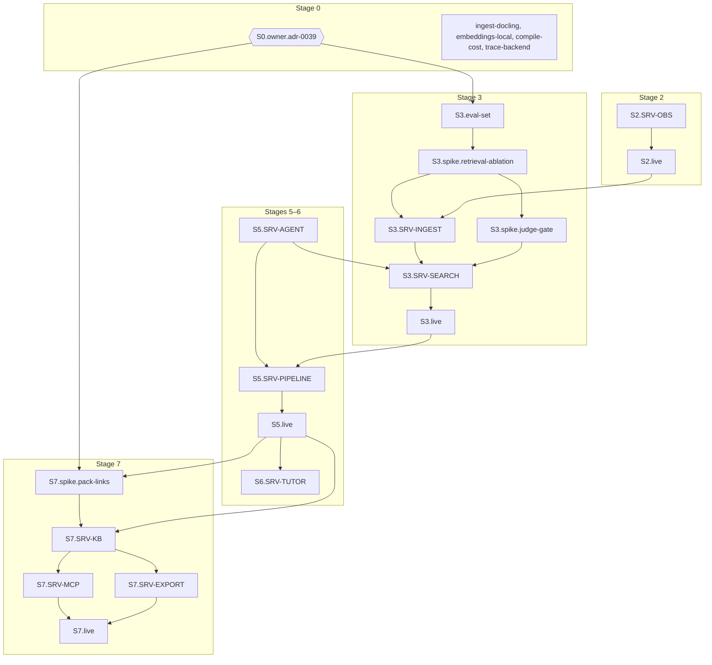

# ADR-0039 execution plan

Reference for every task that ADR-0039 adds or changes. The agent still picks tasks from `docs/progress.yaml` (AGENTS.md "The loop"); this file says, per task, what goes in, the steps, what comes out and how it is checked. Tasks that ADR-0039 does not touch follow `docs/roadmap.md` as they are.

The ADR-0039 part of a task does not start until the owner has accepted ADR-0039 and merged its PR (`S0.owner.adr-0039`); tasks that exist without ADR-0039 (the stage 0 spikes, SRV-OBS, SRV-AGENT) run their roadmap scope until then. The owner's decisions behind this plan are ADR-0039 Context, decisions 1–19.

## Order of the tasks

The hexagon is the owner's step. `S5.SRV-AGENT` comes before `S3.SRV-SEARCH` because the search calls `judge.find` through the `Provider` port that SRV-AGENT introduces (owner, 2026-11-26). SRV-AGENT needs only `S2.live` and `S0.spike.compile-cost`, both done before stage 3. Stage 1, stage 4 and `S7.WEB-KB` are unchanged by ADR-0039 and not shown.

## Rules for every task here

These add to AGENTS.md; they do not replace it.

| Rule | Detail |
| --- | --- |
| One task, one branch | `<stage>/<task-id>` from an up-to-date `main`; the same PR updates `docs/progress.yaml` with the status, the PR link and the measured numbers |
| Commit after every unit | A run may stop at any tool call; only what is committed and recorded survives |
| Spec → Red → Green | Every test carries `@trace <ID>`; a test of an approved spec changes only with the spec (H2) |
| Numbers from measurements | A number in a spec comes from `spikes/<name>/RESULT.md` or a cited source; an unmeasured number is an initial value in config |
| Data, not code | Routes, facets, selection policy, judge slots and prompts are data files with a schema; code only interprets them |
| Fable review | `deep-reviewer` returns `VERDICT: approve` before a spec is approved or code is merged in SRV-INGEST (jobs, idempotency), SRV-SEARCH and the spikes (cost math), SRV-MCP (MCP authorization) and SRV-OBS (OTel context propagation). The verdict goes into the PR description |
| Two failures in a row | After two different fixes of the same check, `investigator`, then act on its FIX and TEST; after three, block the task |
| Who merges | The agent merges specs, tests, code and spikes on green CI. A PR that adds or amends an ADR is merged by the owner (A9) |
| Language | Everything in the repository in English; messages to the owner in Russian |

### Invariants

Each becomes an `INV` line in its module's spec and a test.

1. A pack or overlay build writes only its own rows and never updates another's.
2. Removing a source is one manifest entry. Rows are deleted only by the background collector, never on the request path.
3. Selection over the graph and the embeddings uses only the greedy algorithms of B5. Enumerating subsets, ILP solvers and global recomputation are not used.
4. No free-form tags: closed vocabularies from the facets file; synonyms are concept aliases.
5. At most one `judge.find` call per `find`, made last and only on the cards already selected (B6). On error, timeout or an exhausted budget the response carries `judged: false`.
6. `personal-use` source text (Bashir) never enters the repository, MLflow traces (a hash only) or an MCP response beyond 300 characters per citation.
7. Unreviewed findings never reach agents or judge input; source text in a judge prompt is data, not instructions.
8. A card's ranking prior comes only from the owner's labels and the evaluation set, never from live judge scores.
9. Claude outputs never become tuning data (ADR-0018).
10. MLflow is never on the request path: code reads prompts from the repository, and search works with MLflow stopped.

### Budgets

| Ledger line | Covers | Cap | When reached |
| --- | --- | --- | --- |
| `live_runs_usd` | Spikes and live checks before stage 9 | $40 (in `progress.yaml`) | Block the task; notify the owner |
| `index` | Context prefixes, L2 summaries, link judging | Measured cost per pack + 20% | The job stops, the pack stays usable, the owner tops up |
| `eval` | Evaluation runs and judge alignment | Cost of one run from `judge-gate` × runs per month; the agent proposes the number, the owner approves it | Scheduled runs pause; notify the owner |

Every spend is a `budget.ledger` row with the task, the amount and the line. These lines do not draw on the compile share ($100): 23 × $4.35 = $100.05 already fills it.

## Stage 0

### S0.owner.adr-0039 (owner)

- **In:** branch `s0/adr-0039-knowledge-layers`, `deep-reviewer` verdict `approve`.
- **Steps:** the owner reads ADR-0039, sets `status: accepted` and merges. On rejection: `status: rejected`, and the agent removes the ADR-0039 tasks in one PR, as the comment above `S3.eval-set` in `progress.yaml` says.
- **Unblocks:** the evaluation set, the three ADR-0039 spikes and the MLflow-only form of `trace-backend`.

### S0.spike.trace-backend

- **In:** `S0.spike.agent-sdk-container` done. If ADR-0039 is not accepted yet, the spike compares MLflow and Phoenix as ADR-0018 says.
- **Steps:**
  1. Compose profile `observability`: MLflow pinned at 3.6 or later, storage on a host volume, port bound to `localhost` only.
  2. Rotel exports OTLP/HTTP to MLflow `/v1/traces`.
  3. One Agent SDK call under our stage span through `TRACEPARENT`; the agent's spans nest under ours in the UI.
  4. A feedback assessment attached to a trace and visible in the UI.
  5. Adapter check: do MLflow judges (`make_judge`, the built-in retrieval judges) accept a model called through the Agent SDK? If not, record the fallback: our judge code writes the assessment to MLflow itself.
  6. One prompt file registered in the Prompt Registry, tagged with its commit.
  7. MLflow memory at idle and under one lesson compile (`docker stats`).
- **Out:** `spikes/trace-backend/RESULT.md` with a number per step and a screenshot of a trace with its assessment.
- **Done when:** steps 3 and 4 pass. Otherwise Phoenix covers traces only, and the Prompt Registry, assessments and evaluation need a new ADR.
- **Cost:** a few Agent SDK calls on `live_runs_usd`.

### What earlier spikes add for stage 3

| Spike | Also in its RESULT.md | Why |
| --- | --- | --- |
| `ingest-docling` | Docling elements per page; Russian tokens per chapter; a dump of the elements with their locators in `data/` (not in git: `personal-use`) | The ablation runs on this dump; elements per page set the number of prefix calls; tokens per chapter decide whether a whole chapter fits in a drafting context |
| `embeddings-local` | Vectors for the same dump, saved locally; exact-search p95 over them | The ablation does not re-embed; the p95 is the first point for the rule "exact scan while the vector step p95 ≤ 150 ms" |
| `compile-cost` | Start time of one Agent SDK call on Haiku (the CLI child process) | `judge-gate` cannot predict `find` p95 without it |

## Stage 2: SRV-OBS

MLflow becomes the owner's dashboard: every `find` and every pack build is visible there as a span tree. These rows join the SRV-OBS spec; the rest of SRV-OBS follows the roadmap.

| Part | Requirement | Checked by |
| --- | --- | --- |
| `observability` profile | MLflow and Rotel in their own Compose profile; `reader up` without it is fully functional | Live check: search answers with MLflow stopped |
| `TOOL` root span | Caller (agent and model), `brain_version`, `policy_version`, code version, tool | Unit test with an in-memory exporter |
| Child spans | `ROUTER` (route, filters); `RETRIEVER` per layer; when the gate does not skip the judge, the selection under 1.5 × the budget and `judge.find` on it; then the final selection with its token count | Unit test of the span tree |
| Text in traces | `page_content` carries card text only for `license: shareable`, a content hash for `personal-use` | INV test: a marker phrase from a `personal-use` fixture never appears in exported spans, like the existing secret-canary INV |
| Pack builds | A span per build and link step with counts: spans, mentions, pairs after blocking, judge calls, USD | Unit test on a small openly licensed source |
| Layout in MLflow | Experiments `reader/live`, `reader/eval`, `reader/ingest`; prompts `reader.<slot>`; tags `route`, `judged`, `caller_model` | Live check queries the MLflow API and finds a trace with nested spans |

Steps: spec rows as `REQ` and `INV` → `deep-reviewer` approve → spec `approved` → Red → Green → `e2e/live/stage-2.sh` gains two checks (a nested trace found through the API; the app answers with MLflow stopped).

## Stage 3

Packs, the manifest and `find` appear here, and here the design is measured. Order: evaluation set → ablation → SRV-INGEST and `judge-gate` → SRV-SEARCH (after SRV-AGENT) → live check.

### S3.eval-set

- **In:** the 30 pilot questions with expected pages, `pilot/bashir/plan.yaml`, `pilot/bashir/kb/`.
- **Steps:**
  1. Three types answerable from one book, 30 each: exact ("hardened index offset in BIP-32"), thematic ("how BTC and ETH keys differ"), fact-check. Current-state questions wait for stage 7, which brings sources newer than 2023.
  2. Each record: `id`, type, the question in Russian, expected facts in the agent's own words (≤ 300 characters, never quoted from the book), expected page ranges, `topic` branch.
  3. A schema-checked file in `spec/fixtures/eval/`; the same set registered in MLflow as an evaluation dataset.
  4. The owner reviews a sample of 30 (10 per type). The ablation does not start before the owner's approval.
- **Done when:** 90 records pass the schema and the owner's approval of the sample is recorded in `progress.yaml`.
- **Cost:** built in the interactive session; $0 from the ledger.

### S3.spike.retrieval-ablation

- **In:** the evaluation set, the `ingest-docling` dump, the `embeddings-local` vectors, Postgres from the skeleton, the Agent SDK. If those spikes finished before ADR-0039 was accepted and left no dump or vectors, this spike produces them first, with the same scripts.
- **Variants:** V0 spans only (full-text + vectors, RRF); V1 + context prefix; V2 + L2 summaries; V3 + the `form` filter. Separately: exact scan vs HNSW p95.
- **Steps:**
  1. Prefixes and summaries for two chapters first; project the cost for the book. If the projection exceeds what is left of `live_runs_usd`, stop and ask for a top-up with the number.
  2. Full run V0–V3: recall@10 on expected pages and sufficiency from the evaluation judge, per question type.
  3. Exact McNemar test for each pair of neighbouring variants; every run in MLflow `reader/eval`.
- **Decision rule (ADR-0039 B10):** keep a step if its gain on its question type is significant (in practice a net ≥ 6 of 30). Exact scan while the vector step p95 ≤ 150 ms.
- **Out:** `spikes/retrieval-ablation/RESULT.md`: the variant table, a decision per step, the cost of the Bashir pack and the initial `index` cap (cost + 20%).
- **Review:** `deep-reviewer` on cost math and statistics.

### S3.SRV-INGEST

- **In:** the ablation decisions (which overlays to build); throughput from `ingest-docling`.
- **Spec:**
  - base pack id = sha256(material, parse config); span id = the ADR-0008 locator;
  - overlays: profile, tags, vectors per model, prefixes per prompt version, summaries, only those the ablation kept;
  - append-only manifest, compare-and-swap on the parent entry, one manifest per user;
  - states `building` → `sealed`; a collector with N entries and a minimum age; an immediate `purge` on the owner's command;
  - quote hash and a re-anchoring job for Docling upgrades;
  - the `index` cap per pack; the job stops at 100%.
- **Main test:** a Hypothesis property test. Random add, remove and rebuild sequences give the same active view as a fresh build of the same pack set, over recorded model outputs.
- **Review:** `deep-reviewer` (jobs and idempotency).

### S3.spike.judge-gate

- **Variants:** no judge; judge on every query; judge gated at 3–4 margins. In every judged variant the judge runs last, on the selection under 1.5 × the response budget (B6). Reference: the earlier order (judge on the top 20 before the selection), one run at the best margin.
- **Measures:** Haiku p95 through the Agent SDK; gate fire rate; sufficiency; USD cost of one full evaluation run.
- **Decision rule:** the cheapest variant not significantly worse than the best, not worse by a net > 2 of 30 on any type, with `find` p95 < 2.5 s. The reference is not a candidate. If the judge-last order is significantly worse than the reference or worse by a net > 2 of 30 on any type, block for the owner with both measurements and say that the fixed factor 1.5 may be the cause.
- **Out:** RESULT.md, the initial gate margin in the policy file, the proposed `eval` cap.

### S3.SRV-SEARCH

- **In:** SRV-INGEST, `embeddings-local`, `judge-gate`, and SRV-AGENT for the `Provider` port.
- **Spec:**
  - the B6 cascade in seven steps: route, candidates, merge duplicates, gate, 1-hop expansion capped at 50 and the selection under 1.5 × the budget, all without an LLM call; then one `judge.find` call on that selection only; then the final greedy selection under the budget;
  - `judged` true only when the judge ran; the trace records whether the gate skipped it or it degraded;
  - the score of a card reached only by expansion: the spec defines it before approval (B6 ranks the expanded set by fused score, and such a card was never fused);
  - the route table and a policy file with a schema; `policy_version` = hash of the declared data;
  - the `judge.find` slot through the `Provider` port on the caller's credentials;
  - the B5 greedy algorithms with their bounds, stated per greedy step; the pivot seeded by the request hash;
  - the token budget, clamped to the maximum; a cache key that includes the caller's roles.
- **Tests:**
  - the budget is never exceeded (property);
  - each selection with a stated bound keeps it, checked against exhaustive search on small instances (n ≤ 12); the pivot's bound holds in expectation, so it is checked as a mean over seeds; exhaustive search is allowed in tests only;
  - the same input gives the same response on the judge-free path;
  - the judge receives only the cards of the 1.5× selection, at most one call per `find`;
  - unreviewed findings are never returned.
- **Evaluation, outside CI:** Haiku and a strong model answer the set through `find` and `open`. Targets: Haiku ≥ 90% of the strong model's sufficiency; median ≤ 3 calls; ≤ 2,000 tokens per answer; `find` p95 < 2.5 s; recall@10 ≥ 0.8. Results go to MLflow and the PR description.
- **Review:** `deep-reviewer`.

### S3.live

`e2e/live/stage-3.sh`:

1. Upload the pilot → a new manifest entry.
2. A BIP-32 question → cards with locators.
3. Remove the pack → one entry; search no longer sees it.
4. Restore the pack → the same cards.
5. Stop MLflow → search still works.

## Stages 5–6

### S5.SRV-AGENT (runs before S3.SRV-SEARCH)

- **Slots in `reader.yaml`:** `judge.find`, `judge.link_type`, `ingest.context_prefix` bound to Claude Haiku; `judge.eval.*` bound to a strong Claude model. Replacing a slot's model is a config change, allowed only when the new model is not worse on the evaluation set.
- **Credentials:** `judge.find` runs on the caller's credentials; without a provider the response has no judge. Offline slots run on the pack owner's credentials with caps per pack and per link run.
- **Prompts:** template files in the repository, their hash in every run record; `reader prompts register` registers each new version in MLflow with its commit; `reader eval run` compares a new version with the current one on the evaluation set, outside CI, on the `eval` line, with the result in MLflow and the PR description. A prompt with a regression is not merged.
- **Recorded judge outputs:** keyed by (input hash, judge@version); rebuilds and tests replay them.
- **Alignment:** after 50 owner labels on a judge, SIMBA or GEPA; the result is a new prompt file that passes the same no-regression check. Repeat after each further 50 labels.
- **Review:** `deep-reviewer` (cost and credentials).

### S5.SRV-PIPELINE (ADR-0039 changes only)

- Drafting puts the whole source section in context when its measured token count fits the policy budget (counts from `ingest-docling`).
- Fact-check uses the fact-check route: spans only, source reliability and claim credibility above the policy thresholds.
- Checks after drafting run in this order, and the first failure loops back to the draft: schema and citation presence (rules, 0 model calls) → lab verification → claim support (model) → adversarial review. The limit of 3 loops is unchanged; every return to the draft counts, a rule failure included (owner, 2026-11-26).
- The spec pins whether the lab's independent reference path is built at draft time or in lab verification.
- A test: a draft that fails each of the four checks once stops at the fourth failure.
- Every claim gets an Admiralty credibility 1–6.

### S6.SRV-TUTOR

- The tutor channel boosts cards tied to concepts where the learner has a gap; gaps come from SRV-RECALL and session answers.
- Learner state is not part of `brain_version`, so tutor responses are traced but not promised to replay.
- Evaluation: tutor-route sufficiency not worse than without the boost (not significantly worse, at most a net 2 of 30).

## Stage 7

### S7.spike.pack-links

- **In:** the Bashir pack and two openly licensed sources: BIP texts (only those whose header licence allows use) and Bitcoin Optech topics (MIT).
- **Variants:** A, a pair's links live in an overlay of the later pack; B, one overlay per pair. Both are built in full.
- **Steps:**
  1. Build three packs; run the six-step linking ladder with blocking by concept. The real pair count replaces the estimate "about 15,000 instead of 4 million".
  2. Property test for both variants over recorded judge outputs: random add, remove and rebuild sequences give the same link set as a fresh build.
  3. Measure rows, lines of code and overlays rebuilt when one pack is rebuilt.
  4. Add 30 current-state questions to the evaluation set (version 2; the owner reviews 10).
  5. Ablation of the `role`, `reliability` and `as_of` filters and the current-state route, by the stage 3 rule.
- **Decision rule:** both variants must pass the property test. Pick the one with fewer lines of code, unless the other rebuilds at least 30% fewer overlays.
- **Cost:** link judging on the `index` line, with a cap per link run.

### S7.SRV-KB

- **Registry:** concept ids (`con:bip-32`) are canonical; terms from different packs merge only when the owner approves an alias in the review queue; the registry is read only through the active manifest.
- **Links:** the six-step ladder and the storage variant the spike chose; a link run only for pairs that share a concept; a run's version hashes all its inputs, including the version of the approved concepts.
- **Findings:** `valid_from`, `superseded_by`, credibility 1–6, a computed `orphaned` state; unreviewed findings are invisible to agents.
- **Tests:** the spike's link property test moves into the spec.
- **Review:** `deep-reviewer`.

### S7.SRV-MCP

- **Tools:** `brain_map`, `find`, `open`, `propose`; one card shape; typed ids (`src:`, `sec:`, `con:`, `fnd:`, `spn:`, `les:`).
- **Invariants, each with a test:** filtered by course roles; ≤ 300 characters of `personal-use` text per citation; token budget with clamping; unreviewed findings never returned.
- **Versions:** an optional field may be added in v1; removing or renaming is v2, served next to v1.
- **Evaluation through real MCP:** a Haiku agent connects to the MCP server and answers the whole set (120 questions). Targets: Haiku ≥ 90% of the strong model's sufficiency; median ≤ 3 calls; ≤ 2,000 tokens per answer; `find` p95 < 2.5 s.
- **Review:** `deep-reviewer` (MCP authorization).

### S7.SRV-EXPORT and S7.live

- **Export:** the archive carries the concept registry and the active link runs. INV: export → import reproduces the links. `personal-use` material is listed, never included.
- **`e2e/live/stage-7.sh`:**
  1. `tools/call find` with the MCP headers returns cards.
  2. `propose` with a read-only token is refused.
  3. Add a third source → links appear; remove it → its links are hidden by one manifest entry.
  4. MLflow shows the trace of the MCP call.

## The owner's part

Where a row blocks, the agent sets the task to `blocked` with `reason` and `ask`, notifies the owner and takes the next ready task. Where the owner's part is missing, the agent does what the last column says.

| When | The owner's part | If missing |
| --- | --- | --- |
| Stage 0 | Accept or reject ADR-0039; merge its PR (A9) | ADR-0039 tasks wait; the rest of stages 0–2 runs |
| `S3.eval-set` | Review the 30-question sample | The set is not frozen; the stage 3 spikes wait |
| Stage 3 spikes | Label batches of 25 traces in MLflow (sufficient or not; about 10–12 min each, 4–6 batches) | The gate is measured with the strong model only, without the owner's calibration |
| `S3.SRV-INGEST` | Top up `index` if the measured cost exceeds the cap | Indexing waits; stage 3 search does not start |
| After `judge-gate` | Approve the `eval` cap the agent proposes | No new evaluation runs |
| End of each stage | Run `stage-N.sh`; set specs to `implemented` | The next stage runs; specs stay `approved` |
| Stage 7 | Approve concept aliases in the review queue | Cross-pack links are built without them |
| Stage 7 | Review 10 of the 30 current-state questions | Version 2 is not frozen; the MCP evaluation runs on version 1 |

The agent never does these for the owner: raise an ADR to `accepted`, `rejected` or `superseded`, or a spec to `implemented`; merge a PR that adds or amends an ADR; spend past a ledger line; read secrets or send `personal-use` text out; remove a source without the owner's manifest entry (`purge` is the owner's).

## Risks

| Risk | Signal | Agent's action |
| --- | --- | --- |
| The Agent SDK child-process start eats the `find` p95 budget | Start time in `compile-cost` or `judge-gate` > 0.8 s | A long-lived judge process in the worker; if that is not enough, `find` returns `judged: false` on timeout and the p95 target goes to the owner as a question |
| Prefixes and tags on Haiku cost more than estimated (about 9,000–10,000 calls per book, an assumption) | The two-chapter measurement projects past what is left of `live_runs_usd` (in the ablation) or past the `index` cap (once it is set) | Stop after two chapters, block with the number, ask for a top-up |
| 30 questions per type are too few to separate variants | Net difference below about 6 of 30 | The decision rule already covers it: not significant → the cheaper variant; RESULT.md states the smallest difference the run could detect |
| MLflow does not fit (traces lose context; registry or labelling unusable) | `trace-backend` or SRV-OBS fails its criterion | Traces stay in OTel and Rotel; a new ADR `proposed` with the measurements; the stage 3 spikes run on JSONL files |
| Docling offsets drift on a parser upgrade | The quote-hash re-anchoring test fails on > 1% of spans | The Docling version is pinned in the parse config, hence in the pack id; a new version is a new pack, old citations live through re-anchoring |
| Reading of the Consumer Terms for rewriting judge prompts | Any change in the terms or doubt | The invariant holds: Claude outputs never train weights; on doubt, stop prompt optimisation and ask the owner |
| Cross-pack links fail the property test in both variants | Both red after 3 different fixes | `investigator` after two, `blocked` after three; stage 7 still delivers `brain/v1` on one pack |

## Stop conditions

AGENTS.md "What blocks a task" applies, with two additions:

- the budget condition covers all three ledger lines (`live_runs_usd`, `index`, `eval`) and is checked before the next call that would cross a cap;
- `deep-reviewer` has not returned `VERDICT: approve` after two rounds on the same spec (added to AGENTS.md with this plan).
