# Roadmap: building reader-ai

The build plan from accepted ADRs to the Bashir pilot running daily in the app. Every stage ends with something the owner can use and check on his Mac. Specs are drafted per stage, not all at once, so each spec is written with what the previous stage measured.

## Inputs

| Input | Value | Source |
| --- | --- | --- |
| Decisions | ADR-0001 … ADR-0016, accepted by the owner on 2026-11-20; status flip is the owner's commit (hook H3). ADR-0017 (accounts, export, monetization) and ADR-0018 (agent bus, traces, local models) were added the same day and wait for review | docs/adr |
| Tracks | Every spec belongs to one track: `product`, `ai` or `engineering` (ADR-0001) | spec/_template.yaml |
| v1 / v2 split | v1 builds the product on the owner's Mac plus the groundwork for v2 (export, metering, run traces, quality signals). v2 adds registration and billing on a VPS, the agent bus platform, evaluation, local models and tuning | ADR-0017, ADR-0018 |
| Where the agent works | Claude Code on the owner's Mac, interactive sessions on his subscription | owner, 2026-11-20 |
| Owner time for this project | 30 minutes a day, separate from the 60 minutes of study | owner, 2026-11-20 |
| Where reader-ai runs | Owner's Mac only; a VPS after load is measured (stage 9) | ADR-0012 |
| Agent budget at runtime | $200/month Agent SDK credit, personal use | ADR-0005 |

Two budget facts shape how the work is done:

1. **Building does not spend the $200 credit.** Interactive Claude Code sessions use the subscription's normal usage limits; the Agent SDK credit is spent by the Agent SDK and `claude -p`. The build therefore runs in interactive sessions, never in `claude -p` loops.
2. **Tests never call a live model.** Agent behaviour is tested against recorded SDK transcripts (fixtures under `spec/fixtures/<module>/transcripts/`). Live agent calls happen only in the owner's live checks, on his credit, and appear in the cost ledger. CI has no provider credentials at all (ADR-0005: the subscription token is personal).

## How every stage runs

The agent runs this loop autonomously (ADR-0019, AGENTS.md); the run state is [docs/progress.yaml](progress.yaml). Owner time moves from approving specs before code to reviewing each stage after its live check, so the "Owner sessions" column below is now mostly stage-exit review.

```mermaid
flowchart LR
  spike[Spikes: measure unknown numbers] --> draft[Agent drafts specs]
  draft --> review[Owner reviews, 30-min slots]
  review -->|changes| draft
  review -->|approved| red[Red: failing tests with @trace]
  red --> green[Green: implementation in claimed paths]
  green --> live[Live check on the Mac: e2e/live/stage-N.sh]
  live --> exit[Owner marks specs implemented]
  exit --> replan[Re-estimate next stages from measured velocity]
```



| Step | Who | Output | Check |
| --- | --- | --- | --- |
| Spikes | Agent | `spikes/<name>/RESULT.md` with numbers and the command that produced them | Numbers that change a decision become proposed ADR amendments |
| Spec drafts | Agent | `spec/modules/*.yaml`, `status: draft`, `paths`, FR/INV/NFR/VEC | trace-check T1, T2, T7 |
| Review | Agent, by a fresh subagent (ADR-0019) | `status: approved`, `approved_by: agent` | The owner reviews after, at the stage live check |
| Red | Agent | Tests that fail on assertions, one commit | trace-check T3–T5; the failure reason is the missing behaviour, not an import error |
| Green | Agent | Code in the spec's `paths` only | Tests green; hook H1 and CI T8 |
| Live check | Owner runs it (≈ 5 minutes) | `bash e2e/live/stage-N.sh` prints PASS/FAIL per check against the running stack with `curl` and `jq` | All PASS |
| Exit | Owner | `status: implemented` | — |
| Re-plan | Agent | Updated estimates in this file | Measured days per spec vs estimate |

Live checks follow the owner's preference: real requests against `reader up`, not mocks. They live in `e2e/live/` and are kept for regression; each stage's script also re-runs the previous stages' checks.

**Buffers.** Every stage carries a 25% time buffer. Two re-plan checkpoints (after stage 1 and after stage 4) replace the remaining estimates with measured velocity. Absorbing a slip from one stage is the buffer's job; when a stage overruns its buffer, the next stage's scope is cut before its calendar moves.

## Stages at a glance

| # | Stage | Specs | Usable result | Owner sessions (30 min) | Calendar days (estimate) |
| --- | --- | --- | --- | --- | --- |
| 0 | Groundwork and spikes | — | Numbers behind every open NFR; repository skeleton | 3 | 4–6 |
| 1 | Stack on the Mac | OPS-DEPLOY, OPS-CLI, SRV-CONFIG, SRV-AUTH | `reader up`, passkey sign-in, secrets from Keychain | 6 | 6–9 |
| 2 | Event backbone and notifications | SRV-EVENTS, SRV-OBS, SRV-NOTIFY | Event stream, job queue, Telegram messages | 4 | 4–6 |
| 3 | Ingestion and search | SRV-INGEST, SRV-SEARCH | Bashir PDF ingested; hybrid search with citations | 4 | 5–7 |
| 4 | Lessons and practice | SRV-LESSON, OPS-SANDBOX, SRV-KERNEL, WEB-UI, WEB-NOTEBOOK, WEB-RENDER | A fixture lesson opens in the Calm UI, labs run in the sandbox | 11 | 10–14 |
| 5 | Agents and the compile pipeline | SRV-AGENT, SRV-PIPELINE, WEB-AUTHORING | L02 compiled end to end through gates G1 and G2 | 6 | 8–11 |
| 6 | Daily study loop | SRV-TUTOR, SRV-RECALL, SRV-HABIT, WEB-SESSION | The owner studies Bashir in the app every day | 6 | 7–10 |
| 7 | Knowledge base, export and MCP | SRV-KB, SRV-EXPORT, SRV-MCP, WEB-KB | Claude Code on the Mac queries the sectorized KB; the owner downloads his whole KB as an open archive | 5 | 6–8 |
| 8 | Sharing and paired programs | SRV-SHARE, WEB-COHORT | Second account: viewer, learner, pair session | 4 | 5–7 |
| 9 | Pilot rollout and load measurement | — | All Bashir lessons compiled ahead of study; capacity numbers for the VPS | ongoing | 3–5 for measurement |
| | **Total** | **28 specs** | | **≈ 49 sessions (24.5 h)** | **58–83, with 25% buffer 73–104** |

Calendar days are hypotheses until stage 1 is measured. They assume the owner starts an agent session on most days and the Mac stays awake while the agent works.

## Vertical slice first (owner, 2026-11-20)

The owner wants a working full-stack product on the Mac as early as possible. After stage 1, the agent builds one thin end-to-end path through stages 2–6 before widening any stage:

**Upload the Bashir PDF → ingest → search → compile one lesson (L02) → open it in the browser with running notebook cells → ask the tutor about it.**

| Step | Task id | Minimal scope (the rest of each module comes later, in its own stage) | Built on |
| --- | --- | --- | --- |
| V1 | `V.SRV-JOBS-min` | A Postgres job table with claim/complete/retry (ADR-0006 queue shape), no outbox fan-out or SSE yet | S1.live |
| V2 | `V.SRV-INGEST-min` | Native Docling converter per ADR-0021 (formula model on, code from the text layer); PDF only; the Bashir book into material spans | V1 |
| V3 | `V.SRV-SEARCH-min` | `BAAI/bge-m3` embeddings (spike embeddings-local v2: recall@10 0.675 dense vs 0.400 for e5-small) + Postgres full text; top-k spans with citations | V2 |
| V4 | `V.SRV-LESSON-min` | ADR-0004 lesson notebook format: store, list, open one lesson | S1.live |
| V5 | `V.KERNEL-min` | OPS-SANDBOX + SRV-KERNEL for `python3` only, one `kernel-<user>` service (ADR-0022), the api WebSocket relay | S1.live |
| V6 | `V.WEB-min` | WEB-UI + WEB-NOTEBOOK + WEB-RENDER: sign in, list lessons, open one, run cells; the library from the local build (spike library-publish) | V4, V5 |
| V7 | `V.COMPILE-min` | SRV-AGENT + SRV-PIPELINE: draft → fact-check → review → revise for L02 through `agent-proxy` (ADR-0025); open findings go to G2 as open cells | V3, V4 |
| V8 | `V.TUTOR-min` | SRV-TUTOR: questions about the open lesson, answered from V3's spans with citations | V3, V6, V7 |
| V9 | `V.live` | `e2e/live/slice.sh`: the whole path above against `reader up`, plus the owner opens L02 in the browser | V1–V8 |

**Rules for the slice:**
- Every step is a real module spec with the same gates (H1–H3, review per AGENTS.md). "min" means fewer FRs, not weaker ones. Each spec lists what it defers, by item, to its full stage.
- Accepted ADRs still bind. Where the slice needs something a later stage owns (events, notifications, observability), it uses the smallest form that the full module can replace without migration, and says so in the spec.
- After V9, the stages resume in order and widen the slice: SRV-EVENTS/SRV-NOTIFY/SRV-OBS (stage 2), the rest of stages 3–6, then 7–9.
- Risk: some slice code will be reshaped when the full stage lands. That is accepted in exchange for a usable product weeks earlier.

### Modules by track

| Track | v1 specs (stage) | v2 groundwork inside them |
| --- | --- | --- |
| **product** (12) | SRV-AUTH (1), SRV-NOTIFY (2), SRV-LESSON (4), WEB-NOTEBOOK (4), WEB-AUTHORING (5), SRV-RECALL (6), SRV-HABIT (6), WEB-SESSION (6), SRV-EXPORT (7), WEB-KB (7), SRV-SHARE (8), WEB-COHORT (8) | `owner_id` on every row, consent flags, sign-up behind a disabled flag (SRV-AUTH); always-available export (SRV-EXPORT) |
| **ai** (6) | SRV-SEARCH (3), SRV-AGENT (5), SRV-PIPELINE (5), SRV-TUTOR (6), SRV-KB (7), SRV-MCP (7) | Run records, GenAI spans, ledger with transformation kind and funding (SRV-AGENT); quality signals and event-driven stages (SRV-PIPELINE); answer feedback (SRV-TUTOR) |
| **engineering** (10) | OPS-DEPLOY (1), OPS-CLI (1), SRV-CONFIG (1), SRV-EVENTS (2), SRV-OBS (2), SRV-INGEST (3), OPS-SANDBOX (4), SRV-KERNEL (4), WEB-UI (4), WEB-RENDER (4) | Stage metrics (SRV-OBS); the event log as the bus (SRV-EVENTS) |

12 + 6 + 10 = 28 specs. SRV-NOTIFY is counted under product because its value is the user-facing cue; its adapter port is engineering work inside it.

### Why this order (numbers)

Each stage depends only on stages before it:

| Stage | Needs from earlier stages |
| --- | --- |
| 1 | Spike results (passkeys on localhost, Agent SDK in a container) |
| 2 | Database, api process, auth (1) |
| 3 | Jobs and progress events (2) |
| 4 | Material spans for citations (3), events (2), auth (1) |
| 5 | Sandbox for lab verification (4), search for fact-check (3), jobs (2), notifications for gates (2) |
| 6 | Lessons (4), compiled lessons (5), search (3), notifications (2) |
| 7 | Findings produced by the pipeline (5) and tutor (6) |
| 8 | Everything a second person would use (1–7) |

Rejected orders:

- **UI first.** Stage 4's UI would render 0 real lessons and 0 real outputs; every screen would be redone when real data arrives.
- **MCP early (before stage 6).** The knowledge base would hold 0 findings, because findings come from the pipeline (stage 5) and the tutor (stage 6).
- **Sharing before the study loop.** On a Mac-only instance no partner can reach the app (ADR-0012). Sharing built at stage 2 would sit unused for about 50 days.

---

## Stage 0 — Groundwork and spikes

**Goal:** turn every "measured by a spike" in the ADRs into a number, and set up the repository skeleton. No product code.

### 0.1 Owner prerequisites (one time, ≈ 2 sessions)

| # | Action | Why |
| --- | --- | --- |
| 1 | Set ADR-0001 … 0016 to `accepted` in one commit and merge PR #1 | H3: only the owner raises status |
| 2 | Install Docker Desktop (Apple Silicon), `uv`, Node 26 LTS (`brew install node@26`; proposed ADR-0020), Claude Code | Toolchain for the stack and the agent |
| 3 | ✅ 2026-11-20: `claude setup-token` done; token exported as `CLAUDE_CODE_OAUTH_TOKEN` in the owner's shell → `secret://env/CLAUDE_CODE_OAUTH_TOKEN` | Provider credential (ADR-0005, ADR-0011) |
| 4 | ✅ 2026-11-20: Telegram bot created; token in a private file on the Mac → `secret://hostfile/<path>` (mode 0600, outside git work trees) | Notifier adapter (ADR-0010) |
| 5 | Keep the Bashir PDF at a stable path, for example `~/reader-ai-data/materials/` | Ingestion input; never committed |
| 6 | Optional: add the 30-minute review slot to the calendar | ADR-0010 applies to building too |

### 0.2 Repository skeleton (agent; outside the spec gate)

- `server/pyproject.toml`: Python 3.14 (ADR-0020), uv lockfile, ruff, mypy `--strict`, pytest, anyio, Hypothesis, testcontainers. Package `reader` with entrypoints `reader` (host CLI) and `reader-server --role api|worker|mcp`.
- `web/package.json`: Vite, React 19, TypeScript strict, Vitest, Storybook 10, Playwright.
- CI `layers` job turns on as soon as these manifests exist (already wired).
- `e2e/live/lib.sh`: helpers `check "<name>" <command>` and the PASS/FAIL summary used by every stage script.

### 0.3 Spikes

Each spike is a folder in `spikes/` with a runnable script and `RESULT.md` (numbers, environment, command, date). Spikes never ship.

| Spike | Question | Measure | Pass | Fallback if it fails |
| --- | --- | --- | --- | --- |
| `passkey-localhost` | Do passkeys register and sign in on `https://localhost` behind Caddy's internal CA? | Safari and Chrome on the owner's Mac | Both register and authenticate | `mkcert` certificate for `reader.test` in `/etc/hosts` |
| `agent-sdk-container` | Does the Python Agent SDK run in a linux/arm64 container with `CLAUDE_CODE_OAUTH_TOKEN`, stream text and report cost? | Cold start, first-token latency, `total_cost_usd` present | Streams; cost reported | Run the worker as a host process for agent stages |
| `kernel-roundtrip` | Kernel Gateway with python3, evcxr and deno: image size, cold start per kernel, evcxr first compile of the pilot crates; execute and stream outputs through a WebSocket client | Seconds and MB | Each kernel executes and streams; evcxr warm compile ≤ 10 s | Pre-build more crates; or run Rust labs via `cargo run` in the sandbox |
| `ingest-docling` | Docling on all 935 pages on CPU in Docker | Pages/min, peak RAM, fidelity on 20 pages (10 formulas, 10 tables), OCR on 10 pages rendered as images (Russian) | ≥ 10 pages/min; ≤ 2 of 20 misread | Run the ingestion worker natively on macOS with the Apple GPU (MPS) |
| `embeddings-local` | Which local multilingual embedding model to use (no paid embedding API) | Chunks/s on CPU; recall@10 on 30 pilot questions written by the agent and reviewed by the owner | recall@10 ≥ 0.8; full pilot embedded in ≤ 30 min | A smaller model plus a larger rerank window |
| `compile-cost` | What a full compile of one lesson costs (draft, fact-check, review) on the owner's subscription | Tokens, $, minutes for L02 | ≤ $4.35 and ≤ 45 min | Cheaper model per task; fewer review loops; ADR-0005 budget amendment |
| `library-publish` | Publish `ui-builder-lib-with-agents` (from `web3/material-parity`) to GitHub Packages through a release workflow in its repository that runs its gates; consume the version in Vite and Storybook 10; apply a draft Calm token file | Release time; bundle size of the 20 components reader-ai needs; contrast of Calm | Package installs by version; Calm passes 4.5:1 and 3:1 | Consume a built commit until the release workflow is green |
| `trace-backend` | MLflow or Phoenix as the trace backend on the Mac, fed through Rotel with our parent spans and the Agent SDK's native traces joined by `TRACEPARENT` | Memory at idle and under one lesson compile; minutes to find why a seeded failing stage failed; whether quality scores attach to the trace | Agent spans nest under our stage span; a score is visible on the trace | The other backend; Collector config is the only change |

The library release workflow is work in the library's repository and follows its own process (AGENTS.md there); reader-ai only consumes released versions (ADR-0013).

**Exit:** 8 RESULT.md files; any number that changes a decision becomes a proposed ADR amendment for the owner.
**Owner:** 1 session reading results, plus prerequisites.
**Hands to stage 1:** passkey host name, worker placement (container or host), kernel set confirmed.

---

## Stage 1 — Stack on the Mac

**Goal:** `reader up` brings up an empty, healthy stack with passkey sign-in and secrets from the Keychain.

| Spec | Paths | Key requirements |
| --- | --- | --- |
| `SRV-CONFIG` | `server/src/reader/config/**` | FR: load and validate `reader.yaml`; export its JSON Schema; resolve `secret://env` and `secret://file`. INV: a `SecretRef` field never accepts a literal value. INV: a resolved secret value never appears in logs, events or error messages (canary test). VEC: `deploy/reader.example.yaml` validates |
| `OPS-CLI` | `server/src/reader/cli/**` | FR: `reader up/down/status`; resolve `secret://keychain` (macOS Keychain, Windows Credential Locker, Linux Secret Service through `keyring`) and `secret://op` on the host, and hand values to Compose only as environment of the child process. FR: `reader doctor`, `reader secrets set`, `reader trust` (Caddy root CA), `reader backup`/`restore`. INV: no resolved secret is written to any file (scan of the work directory and `docker inspect` after `up`) |
| `OPS-DEPLOY` | `deploy/**` | FR: compose.yaml with six services, three networks, named volumes and healthchecks; arm64 images; Caddyfile with internal TLS, security headers and routes. NFR: `reader up` to all healthy ≤ 120 s with images built (verified_by: bench) |
| `SRV-AUTH` | `server/src/reader/auth/**` | FR: bootstrap link registers the owner's passkey; passkey sign-in and sign-out; sessions in Postgres. INV: cookie HttpOnly, Secure, SameSite=Lax. FR: sign-in attempts rate-limited. Invitations are stubbed and finished in stage 8. Groundwork (ADR-0017, ADR-0018): INV every user-owned table has `owner_id`; per-user consent flags for evaluation and tuning; self-service sign-up implemented behind a disabled flag |

**Live check** `e2e/live/stage-1.sh`:

```bash
reader up
check "health"          curl -fsS https://localhost/api/health | jq -e '.db=="ok"'
check "anonymous 401"   test "$(curl -s -o /dev/null -w '%{http_code}' https://localhost/api/me)" = 401
# Four default-profile services (OPS-DEPLOY, owner 2026-11-20): caddy, api, worker, postgres. Not six: mcp arrives in
# stage 7 (profile mcp), the kernel services in stage 4 (profile kernels), Rotel with SRV-OBS in stage 2.
check "four healthy"    test "$(docker compose -f deploy/compose.yaml ps --format json | jq -s '[.[]|select(.Health=="healthy")]|length')" = 4
# Secret checks (ADR-0026, OPS-DEPLOY FR-DEPLOY-10, INV-DEPLOY-2): one function per check, each looping per container,
# so `check` sees the whole verdict and no pipe sits outside it.
CONSUMERS="postgres api worker"   # mcp and agent-proxy join in later stages
no_canary_in_inspect() { local c; for c in $(docker compose -f deploy/compose.yaml ps -q); do
  docker inspect "$c" | grep -q "$READER_CANARY" && return 1; done; return 0; }
no_secret_in_diff() { local c; for c in $(docker compose -f deploy/compose.yaml ps -q); do
  docker diff "$c" | grep -q '^A /run/secrets/.' && return 1; done; return 0; }   # paths below the mount point only
secret_files_ok() { local s uid; for s in $CONSUMERS; do
  uid=$(docker compose -f deploy/compose.yaml exec -T "$s" id -u) || return 1
  [ "$(docker compose -f deploy/compose.yaml exec -T "$s" stat -c '%a %u' /run/secrets/db-password)" = "600 $uid" ] || return 1
  done; return 0; }
# `reader up` above returned 0 with `depends_on: service_healthy` declared: delivery runs concurrently with `up` and the
# watcher keeps running (ADR-0026; spikes/compose-secrets-ro case e). The watcher's stop command is fixed by OPS-CLI's
# spec; `reader watcher stop` stands for it here.
health_of() { docker inspect -f '{{.State.Health.Status}}' "$(docker compose -f deploy/compose.yaml ps -q "$1")"; }
healthy_with_file_within() { local s="$1" n="$2"; for _ in $(seq "$n"); do
  [ "$(health_of "$s")" = healthy ] && docker compose -f deploy/compose.yaml exec -T "$s" test -s /run/secrets/db-password \
    && return 0; sleep 2; done; return 1; }
redelivered_by_watcher() { docker compose -f deploy/compose.yaml restart api >/dev/null || return 1
  healthy_with_file_within api 30; }                            # no second `reader up`
fails_closed_without_watcher() { reader watcher stop || return 1
  docker compose -f deploy/compose.yaml restart api >/dev/null || return 1
  sleep 20; [ "$(health_of api)" != healthy ] || return 1      # no file, no watcher: stays unhealthy (FR-DEPLOY-10 d)
  reader up >/dev/null || return 1; healthy_with_file_within api 30; }
postgres_restarts_without_file() { reader watcher stop || return 1   # hypothesis of FR-DEPLOY-10 d: PGDATA initialised,
  docker compose -f deploy/compose.yaml restart postgres >/dev/null || return 1   # so the wrapper does not need the file
  for _ in $(seq 30); do [ "$(health_of postgres)" = healthy ] && { reader up >/dev/null; return $?; }; sleep 2; done
  reader up >/dev/null; return 1; }
record_consumer_peaks() { local s; for s in $CONSUMERS; do      # cgroup v2 high-water mark since container start
  printf '%s memory.peak=%s\n' "$s" "$(docker compose -f deploy/compose.yaml exec -T "$s" cat /sys/fs/cgroup/memory.peak)" >&2 \
    || return 1; done; return 0; }                              # FR-DEPLOY-9 limits are revised from these
check "no env secrets"          no_canary_in_inspect
check "no secret on disk"       no_secret_in_diff
check "secret files 0600, owner = service uid" secret_files_ok
check "re-delivered by the watcher after a restart" redelivered_by_watcher
check "fails closed without the watcher" fails_closed_without_watcher
check "postgres restarts without its file" postgres_restarts_without_file
check "postgres hardened"       test "$(docker inspect -f '{{.Config.User}} {{.HostConfig.ReadonlyRootfs}}' "$(docker compose -f deploy/compose.yaml ps -q postgres)")" = "999:999 true"
check "consumer memory recorded" record_consumer_peaks
check "doctor"          reader doctor --json | jq -e 'all(.[]; .ok)'
# manual, once: open the bootstrap link in Safari, register a passkey, then:
check "signed in"       curl -fsS -b ~/.reader/cookie https://localhost/api/me | jq -e '.role=="owner"'
```

**Exit:** all PASS on the owner's Mac; backup-restore drill reproduces an empty instance.
**Owner:** 4 spec reviews (≈ 4 sessions), 1 passkey registration, 1 live check.
**Re-plan checkpoint 1:** measured days per spec replace the estimates for stages 2–9.
**Hands to stage 2:** database, api skeleton, auth middleware, config models, CLI.

---

## Stage 2 — Event backbone and notifications

**Goal:** every later feature is "write state + append event" in one transaction; jobs and streams work; Telegram delivers.

| Spec | Paths | Key requirements |
| --- | --- | --- |
| `SRV-EVENTS` | `server/src/reader/events/**`, `server/src/reader/jobs/**` | FR: typed event registry; transactional outbox; SSE `/api/events` resumable by `Last-Event-ID`; procrastinate queue with idempotency key; TypeScript event types generated for `web/`. INV: state change and event commit together or not at all (property test with injected failures). INV: a job killed mid-run is retried and its effect happens once. NFR: event to SSE client p95 ≤ 200 ms on the Mac |
| `SRV-OBS` | `server/src/reader/obs/**`, `deploy/otel/**` | FR: structlog JSON with secret redaction; trace id on every request, job and event; Rotel (Rust OpenTelemetry collector) as a standalone service and an optional `observability` Compose profile running the backend chosen in stage 0; `agent_runs` and the ledger are never derived from telemetry; metrics registry where later stages declare their stage metrics (pass rate, loops, cost and latency percentiles). INV: canary secret never appears in a log line or span attribute |
| `SRV-NOTIFY` | `server/src/reader/notify/**` | FR: `Notifier` port with adapters declared in config; Telegram adapter with Bot API long polling; chat linking by one-time `/start <token>` deep link; per-user event filter and quiet hours; delivery as jobs with retry and idempotency per (user, event, channel). FR: adding a channel is one adapter class plus its config schema (tested with a fake webhook adapter) |

**Live check** `e2e/live/stage-2.sh`: open an SSE stream with `curl -N`, post a dev ping, and see it arrive. Restart with `Last-Event-ID` and see no gap. Kill the worker during a sleep job and see it complete once. Link Telegram, call `POST /api/notifications/test`, and see the message on the phone.

**Exit:** all PASS; the owner receives the Telegram test message.
**Owner:** 3 spec reviews, 1 live check.
**Hands to stage 3:** jobs with progress events, notifier for "ingestion done".

---

## Stage 3 — Ingestion and search

**Goal:** the Bashir PDF is ingested with a complete outline and searchable chunks that carry their source spans.

| Spec | Paths | Key requirements |
| --- | --- | --- |
| `SRV-INGEST` | `server/src/reader/ingest/**` | FR: upload with sha256 dedupe; outline-first order (PDF bookmarks → EPUB nav → DOCX headings → HTML/Markdown headings → layout → agent proposal); Docling content with OCR for image pages; EPUB read directly; URL fetch with limits (same domain, depth 2, ≤ 200 pages, robots.txt); git repository snapshot; per-material limits and license from config. INV: every chunk has a span (material sha256, page or file+lines, char offsets). VEC: Bashir outline has 494 bookmarks, 23 chapters, contiguous chapter ranges (fixture stores counts and a hash of the normalised outline, not the titles). NFR: throughput from `ingest-docling` |
| `SRV-SEARCH` | `server/src/reader/search/**` | FR: local embedding model from `embeddings-local`; pgvector HNSW; full-text with Russian and English configurations; reciprocal rank fusion; vectors tagged with model id; re-embed job. NFR: recall@10 ≥ 0.8 on the 30-question pilot set (VEC fixture with expected page ranges) |

**Live check** `e2e/live/stage-3.sh`: `curl -F file=@$BASHIR_PDF /api/materials` → id; SSE shows progress to `material.ingested`; `/api/materials/{id}/outline` reports 494 bookmarks; `/api/search?q=...` for 5 known questions returns hits inside the expected pages.

**Exit:** all PASS; ingestion time of the full PDF recorded for stage 9.
**Owner:** 2 spec reviews, 1 review of the 30-question set, 1 live check.
**Hands to stage 4:** material spans for citations; search for the tutor and fact-check.

---

## Stage 4 — Lessons and practice

**Goal:** a lesson opens in the Calm UI, its labs run in the sandbox, and notes survive republishing. This is the largest stage, so it runs in two halves with their own live checks.

### 4a — Backend and sandbox

| Spec | Paths | Key requirements |
| --- | --- | --- |
| `SRV-LESSON` | `server/src/reader/lessons/**` | FR: cell schema (ADR-0004 kinds) as JSON Schema; lesson revisions as immutable blobs; learner state keyed by cell id; course index. INV: every stored lesson passes `nbformat.validate` and the cell schema. INV: write → read → write is byte-identical. INV: republishing never changes `notes` cells or learner state. VEC: fixture lesson `F01` (one cell of every kind, including the Nakamoto lab with its known values) |
| `OPS-SANDBOX` | `sandbox/**` | FR: image with python3, evcxr and deno kernels and the pilot's pre-built crates; ADR-0014 hardening; egress proxy with per-lab allowlist. Tests run inside the kernel: cannot resolve `postgres` or `api`; no internet without an allowlist; `/run/secrets` absent; killed at memory, CPU and PID limits; allowlisted host reachable, others refused |
| `SRV-KERNEL` | `server/src/reader/kernels/**` | FR: authenticated WebSocket relay to Kernel Gateway; one kernel per (user, lesson, language); idle culling; per-participant execution attribution (used by pair sessions in stage 8). NFR: cell execute-to-first-output p95 ≤ 500 ms for a trivial Python cell |

### 4b — UI

| Spec | Paths | Key requirements |
| --- | --- | --- |
| `WEB-UI` | `web/src/ui/**`, `web/.storybook/**` | FR: library consumed from the pinned build; Calm tokens (light and dark) as W3C Design Tokens compiled to `--acme-*` variables; no gradients, glass or glow (CSS check); Storybook 10 with the library gallery under Calm and the live token editor exporting a JSON patch. NFR: text contrast ≥ 4.5:1, control borders ≥ 3:1 in both modes (verified_by: test) |
| `WEB-NOTEBOOK` | `web/src/notebook/**` | FR: cell components per kind; run cell and stream outputs; editable `notes`; ipywidgets (controls and output only); keyboard navigation between cells. Stories for each cell kind with real nbformat fixtures |
| `WEB-RENDER` | `web/src/render/**` | FR: rendering matrix of ADR-0013. INV: `text/html` and `image/svg+xml` outputs render only in a sandboxed iframe; a script in an output cannot read `document.cookie` of the app (Playwright test) |

**Design gate (owner, 2 sessions):** the owner reviews Calm in Storybook (`https://localhost/storybook`) and adjusts tokens live. The exported JSON patch becomes a PR. Nothing in 4b is marked implemented before this gate.

**Live check** `e2e/live/stage-4.sh`:
- `/api/health` reports `.kernel=="ok"` (moved from stage 1, owner 2026-11-20);
- every kernel service of profile `kernels` is healthy;
- store fixture lesson F01 and check that `/api/lessons/F01` validates;
- a Playwright run opens F01, executes the Nakamoto lab and sees the assert pass;
- a lab cell that tries `curl http://postgres:5432` fails;
- a lab cell cannot connect to any port of its declared caller (api or worker), per OPS-DEPLOY FR-DEPLOY-4;
- `/storybook` answers 200.

**Exit:** all PASS; the owner opens F01, runs a lab and writes a note. The first real lesson arrives through the pipeline in stage 5.
**Owner:** 6 spec reviews, design gate, 2 live checks.
**Re-plan checkpoint 2:** stages 5–9 re-estimated from stages 1–4.
**Hands to stage 5:** lesson format and storage, sandbox for lab verification, UI components for gate screens.

---

## Stage 5 — Agents and the compile pipeline

**Goal:** a lesson is compiled from the material through all seven stages and both owner gates, within budget.

| Spec | Paths | Key requirements |
| --- | --- | --- |
| `SRV-AGENT` | `server/src/reader/agent/**` | FR: `Provider` port; Agent SDK adapter for `anthropic-subscription`, `anthropic-api`, `bedrock`, `vertex`; model per task class from config; prompt files versioned and hashed into provenance; cost ledger row per SDK result, tagged with `transformation_kind`, `funding` and pages of material processed (ADR-0017); budgets warn at 80% and stop new jobs at 100% with an event and a notification. FR: one `agent_runs` record and one OTel span tree with `gen_ai.*` attributes per run; content capture off for `personal-use` material (ADR-0018). INV: a request runs only with credentials owned by the user it is attributed to. Tests replay recorded transcripts; no live model in CI |
| `SRV-PIPELINE` | `server/src/reader/pipeline/**` | FR: `stages.yaml` interpreter; stages ingest → plan (G1) → draft → fact-check → lab verification → adversarial review → publish (G2). The plan stage also proposes the top-level sector taxonomy for G1 (ADR-0015). Idempotent by `(lesson, stage, input_sha256)`; at most 3 loops back to draft, then the owner is asked. INV: a lesson with an uncited claim, a failing lab or an open blocking finding cannot reach G2. INV: the review stage starts with a fresh context that contains none of the draft conversation. INV: a stage starts only from a `stage.completed` event, never from a direct call (the bus, ADR-0018). FR: quality signals attach to runs: fact-check findings, lab failures, blocking review findings, G2 return reasons from a fixed list. NFR: compile cost per lesson ≤ $4.35 (verified_by: bench, live) |
| `WEB-AUTHORING` | `web/src/authoring/**` | FR: G1 screen (plan, order, sessions, sector taxonomy) and G2 screen (lesson diff, findings, costs, approve/return); progress over SSE; Telegram notification when a gate waits |

**Live check** `e2e/live/stage-5.sh`: request a course plan → G1 waiting (Telegram arrives) → approve → compile L02 → SSE shows each stage → G2 waiting → publish; `/api/costs?lesson=L02` total ≤ $4.35; a seeded uncited claim blocks G2.

**Exit:** L02 published through the pipeline; its cost and duration recorded.
**Owner:** 3 spec reviews, G1 for the whole Bashir plan, G2 for L02, 1 live check.
**Hands to stage 6:** compiled lessons ahead of study; agent port and ledger for the tutor.

---

## Stage 6 — Daily study loop

**Goal:** the owner studies Bashir in the app every day; the four laws are measured.

| Spec | Paths | Key requirements |
| --- | --- | --- |
| `SRV-TUTOR` | `server/src/reader/tutor/**` | FR: context bound to the current cell, its citations and the learner's notes, plus retrieval; asks before it tells; every factual answer cites a span or URL; difficulty calibrated to 80–90% correct answers; token stream over SSE; one-tap answer feedback (useful / wrong / unclear) recorded as a quality signal on the run. NFR: first token p95 ≤ 3 s |
| `SRV-RECALL` | `server/src/reader/recall/**` | FR: cards from `recall` cells; FSRS scheduling (`py-fsrs`) with target retention 0.90 per course; review API. INV: card state is per learner and never stored in the notebook |
| `SRV-HABIT` | `server/src/reader/habit/**` | FR: implementation intention (time, place, habit stack) per course; habit tracker; never miss twice: after one missed day the next plan shrinks to the two-minute version and the cue goes out through SRV-NOTIFY. Metrics: interactions and seconds to the first study action, share of sessions started within 30 minutes of the cue, longest run without two misses, recall accuracy |
| `WEB-SESSION` | `web/src/session/**` | FR: home with exactly one next step; one-click resume to the exact cell; two-minute entry action; focus mode; session close (what changed today); long-run view across weeks and months. NFR: ≤ 2 interactions and ≤ 10 s from opening the app to the first study action (Playwright) |

**Live check** `e2e/live/stage-6.sh`: friction NFR via Playwright; a tutor question on an L01 cell returns a cited answer; a recall review reschedules a card; simulate a missed day → the next day's plan is the two-minute version and Telegram sends the cue.

**Exit:** 7 consecutive days of real study by the owner in the app (Bashir S01), with the habit metrics recorded. From this point the Bashir study runs in reader-ai.
**Owner:** 4 spec reviews, 1 live check, 7 days of use (inside the 60-minute study time).
**Hands to stage 7:** findings from tutor sessions and the pipeline.

---

## Stage 7 — Knowledge base, export and MCP

**Goal:** what the owner learns is organised by sectors, can be downloaded at any time as an open archive, and is available to any agent over MCP.

| Spec | Paths | Key requirements |
| --- | --- | --- |
| `SRV-KB` | `server/src/reader/kb/**` | FR: sectors top-down (taxonomy approved at G1, lower levels grow from findings); findings of 7 kinds with citations, sectors, origin and `verified`; links (supports, contradicts, supersedes, depends_on); review queue for proposed findings; data for the "book turned around" view (each source section → sectors × learner state). The Claude Docs knowledge base stays a raw snapshot in `pilot/bashir/kb/` in v1; turning it into findings is the v2 epic "Raw knowledge import" |
| `SRV-MCP` | `server/src/reader/mcp/**` | FR: MCP 2026-07-28 over Streamable HTTP at `/mcp` and stdio; tools `list_sectors`, `get_sector`, `search`, `get_finding`, `get_lesson_outline`, `propose_finding`; resources mirroring the read tools; personal access tokens with scopes `kb:read` and `kb:write` (OAuth waits for the VPS); results filtered by course roles. INV: for `personal-use` material no citation carries more than 300 characters of source text |
| `SRV-EXPORT` | `server/src/reader/export/**` | FR: on-demand export as the open archive of ADR-0017 (Markdown findings with frontmatter and wikilinks, `.ipynb` lessons, notes, recall CSVs, own transcripts, own uploads, `manifest.json` with sha256 per file); available on every plan and to read-only accounts; import of an archive into an empty instance. INV: export → import reproduces findings, sectors, links, lessons, notes and recall state. INV: material shared with the user under `personal-use` is listed, never included |
| `WEB-KB` | `web/src/kb/**` | FR: sector map; finding pages with citations; review queue; the "book turned around" view for the Bashir pilot; "Download my knowledge" in account settings |

**Live check** `e2e/live/stage-7.sh` (export part): `curl -fsS -b ~/.reader/cookie -o kb.zip https://localhost/api/export` → `unzip -t kb.zip`; every sha256 in `manifest.json` matches; import into a scratch instance and compare counts.

**Live check** `e2e/live/stage-7.sh` (MCP part): `claude mcp add --transport http reader https://localhost/mcp --header "Authorization: Bearer $READER_PAT"`; a raw `tools/call search` request with `MCP-Protocol-Version`, `Mcp-Method` and `Mcp-Name` headers returns findings; a `propose_finding` call with a read-only token is refused; with `kb:write` it lands in the review queue.

**Exit:** Claude Code on the Mac answers a blockchain question from the owner's own findings with citations; the owner's export opens in Obsidian and re-imports cleanly.
**Owner:** 4 spec reviews, 1 review of the top-level taxonomy, 1 live check.
**Hands to stage 8:** role filtering in place for MCP; findings to share.

---

## Stage 8 — Sharing and paired programs

**Goal:** a second person can follow, learn and pair, each on their own provider. On the Mac-only instance this is verified with a second account in another browser profile; real partners join after the VPS.

| Spec | Paths | Key requirements |
| --- | --- | --- |
| `SRV-SHARE` | `server/src/reader/share/**` | FR: role matrix (viewer, learner, mentor, editor, owner) on every endpoint and MCP tool; invitation links with role and expiry; a member with no provider is a viewer until they connect one; own materials per member; cohort board; pair sessions on one kernel with per-participant attribution; mentor view of learners' stages; partner check-ins through SRV-NOTIFY (opt-in). INV: an agent request is never executed with another member's credentials. INV: `personal-use` source files are never served to another member |
| `WEB-COHORT` | `web/src/cohort/**` | FR: invite flow; cohort board; pair session UI (shared kernel, both members' tutor turns in one chat); mentor dashboard |

**Live check** `e2e/live/stage-8.sh`: invite a second account as learner. Before it connects a provider, a tutor call returns 403 (viewer). After it connects its own API key, a tutor call is billed to its ledger, not the owner's. In a pair session both accounts run cells in one kernel with correct attribution. Downloading the owner's PDF as the second account returns 403.

**Exit:** all PASS with two local accounts.
**Owner:** 2 spec reviews, 1 live check (needs an API key for the second account, or a friend's).
**Hands to stage 9:** a complete v1.

---

## Stage 9 — Pilot rollout and load measurement

**Goal:** the Bashir course is compiled ahead of the owner's study, the knowledge base has moved in, and the numbers for the VPS decision exist.

- **Rolling compile.** Keep the next two plan stages (S01–S16) compiled and published ahead of where the owner studies. Each lesson costs one G2 review (≈ 10–15 minutes inside the 30-minute slot). At ≤ $4.35 per lesson, the 21 lessons after L01–L02 cost ≤ $92 of credit, spread over the months of study.
- **Knowledge-base snapshot.** The Claude Docs tabs (plan, decision journal, glossary, forks, chapter index, chapter 1) are already in `pilot/bashir/kb/` as raw Markdown (moved 2026-11-20); the owner reads them there while v1 runs. Turning them into findings, sectors and lessons is the v2 epic "Raw knowledge import".
- **Load measurement** on the Mac for two weeks of real use: jobs per hour and queue latency, kernel memory per session, ingestion CPU minutes per 100 pages, concurrent tutor streams, Postgres size growth. Written to `docs/capacity.md`; a new ADR sizes the VPS from these numbers.

**Exit:** two plan stages compiled ahead; `docs/capacity.md` with two weeks of measurements; VPS ADR proposed.

---

## v2 backlog

v2 starts after stage 9 delivers capacity numbers. Its items are epics; each becomes ADRs and specs when it is scheduled. The v1 groundwork that feeds each epic is listed so nothing in v2 waits on data v1 failed to collect.

| Epic | Track | Scope | Fed by v1 groundwork | Source |
| --- | --- | --- | --- | --- |
| VPS deployment | engineering | Production host sized from `docs/capacity.md`; public TLS; off-site backups; Telegram webhooks; MCP OAuth | Stage 9 measurements | ADR-0012 |
| Open registration | product | Self-service sign-up, email or passkey onboarding, provider connection wizard | `owner_id` everywhere, sign-up flag (SRV-AUTH) | ADR-0017 |
| Bring your own agent (Free) | product | The pipeline as MCP tools, prompts and a skill pack for Claude Code and Codex; reader-ai validates every stage's output and runs labs in its sandbox; free-tier quotas | SRV-MCP, SRV-PIPELINE stages as data | ADR-0017 |
| Plans and billing (Pro, Max) | product | `plans.yaml` with credits in pages and tutor sessions; CI check that every price ≥ measured cost ÷ 0.3 (70% gross margin); managed runs on reader-ai API keys; invoices, usage page | Ledger with `transformation_kind`, `funding`, pages (SRV-AGENT) | ADR-0017 |
| Agent bus platform | engineering | Agents as subscribers with typed topic contracts, topic replay into a new agent version, dead letters, per-agent concurrency and budgets | Event-driven stages (SRV-PIPELINE, SRV-EVENTS) | ADR-0018 |
| Custom agent pipeline with per-agent control | ai | Each agent declared with its own model, provider, prompt version, tools, budget, switch and history, controlled one by one in the UI; Claude Agent SDK is the first integration behind it | Model per task as data, `agent_runs` (SRV-AGENT) | ADR-0018 |
| Raw knowledge import | ai | Pipeline stages that transpile raw knowledge (the Claude Docs snapshot, notes, exports of other tools) into findings, sectors, links and lessons, with the same fact-check and owner review as compiled material | Raw snapshot in `pilot/bashir/kb/`; SRV-KB model; pipeline stages | ADR-0009, ADR-0015 |
| Trace dashboards | engineering | Stage-quality dashboards on the backend chosen in stage 0 | `agent_runs`, spans, stage metrics (SRV-AGENT, SRV-OBS) | ADR-0018 |
| Evaluation harness | ai | Eval sets from labelled runs; regression gate on prompt or model changes; side-by-side comparisons | Quality signals (SRV-PIPELINE, SRV-TUTOR, SRV-RECALL) | ADR-0018 |
| Local inference | ai | `openai-compatible` provider; GX10 endpoint (spike: vLLM, SGLang, llama.cpp); MLX on the Mac for embeddings and classification | Model per task as data (SRV-AGENT) | ADR-0018 |
| Agent loop for local models | ai | Tool-using agent runtime for non-Claude models | Provider port (SRV-AGENT) | ADR-0018 |
| Routing by measured quality | ai | Task → model chosen from eval results and cost | Eval harness | ADR-0018 |
| Tuning on the GX10 | ai | LoRA/QLoRA from curated datasets (no Claude outputs); promotion only after beating the baseline on the eval set | Consent flags, quality signals, human labels | ADR-0018 |
| Performance and cost optimization | engineering | Prompt and context caching, batch compilation, cheaper models per task where evals allow, ingestion on the GX10 GPU | Stage metrics, ledger | ADR-0005, ADR-0018 |

## Risks and triggers

| Risk | Trigger (number) | Response |
| --- | --- | --- |
| Passkeys fail on `localhost` in Safari | `passkey-localhost` spike fails | `mkcert` + `reader.test` host name |
| Docling too slow on CPU in Docker | < 10 pages/min | Ingestion worker runs natively on macOS with MPS |
| Compile cost over budget | > $4.35 per lesson in `compile-cost` or stage 5 | Cheaper model for draft and fact-check; fewer review loops; owner decides on an ADR-0005 amendment |
| Claude Code usage limits slow the build | A stage overruns its 25% buffer because sessions hit limits | Cut the next stage's scope first, then move its calendar |
| The Mac sleeps during long jobs | A compile or ingestion job interrupted | `reader up` holds a power assertion (`caffeinate`) while jobs run; jobs are idempotent and resume |
| The pinned library commit lacks a needed component | A screen needs a component not on `acc9e4a` | The component is built through the library's own workflow in its repository; reader-ai moves its pin |
| evcxr cold compile too slow | > 10 s warm compile for pilot crates | Pre-build crates in the image, or run Rust labs through `cargo` in the sandbox |
| Mac-only blocks real paired study | A partner is ready before stage 9 | Bring the VPS ADR forward with the stage 8 numbers |
| v2 groundwork crowds out v1 | Groundwork items take more than 15% of a stage's days | Keep only the data capture (run records, signals, `owner_id`); move the rest to v2 |
| Rotel misses a feature or misbehaves | A span type is dropped or a needed processor is missing | Switch the collector service to the Go OTel Collector: both speak OTLP, so it is a Compose change |
| Tuning data mixes in Claude outputs | A dataset build reads a run produced by a Claude model | Dataset builder filters by provider; test with a seeded Claude run (ADR-0018 training data rule) |

## Glue between stages

| Produced in | Used in | What |
| --- | --- | --- |
| 0 | 1, 3, 4, 5 | Spike numbers become NFR thresholds |
| 1 | all | Config models, CLI, auth middleware, deploy stack |
| 2 | 3, 5, 6, 8 | Events, jobs, SSE, notifier |
| 3 | 4, 5, 6 | Spans for citations, search |
| 4 | 5, 6, 8 | Lesson storage, sandbox, kernel relay, Calm components |
| 5 | 6, 7, 9 | Agent port, ledger, compiled lessons, sector taxonomy |
| 6 | 7, 9 | Findings from study, habit metrics |
| 7 | 8 | Role-filtered KB access |
| 8 | 9 | Multi-user model for the VPS |
| 9 | next ADR | Capacity numbers |
